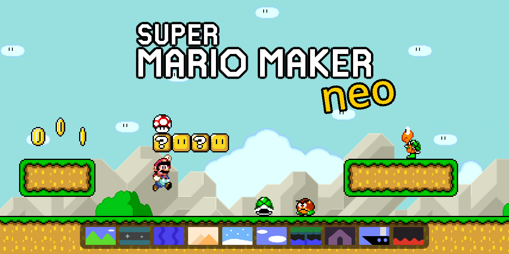

# SMMneo / SuperMarioMaker_neo



An independent GodotWE-based project developing a playable Super Mario World
subset of Super Mario Maker-style gameplay and course editing.

The base engine and editor are [GodotWE](https://github.com/NCubss/GodotWE) by
NCubs and contributors. SMM:WE OpenWE, by Franyer Farias and its contributors,
is used as a behavior reference. The original GodotWE commit history is
retained. This project has its own development scope and is not an official
GodotWE or Nintendo release.

## Development status

The `SMMneo` branch contains the current GodotWE-based implementation. Existing
`main` and historical branches belong to the earlier project and are preserved.

Implemented systems include the documented SMW player powers and swimming,
enemy subset, editor placement and history, block contents, terrain and slopes,
ten SMM2 course themes with a day/night toggle, springs, semisolid platforms and
a subset of SWE loading and saving. Feature parity, all object combinations,
other game styles, area travel and online services remain incomplete.

- [Current setup and review guide](docs/porting/CURRENT.md)
- [Implementation explanations in Chinese](docs/porting/IMPLEMENTATION-GUIDE.zh-CN.md)
- [Architecture](docs/porting/ARCHITECTURE.md)
- [Feature history and verification records](docs/porting/HANDOFF.md)
- [Contribution rules](CONTRIBUTING.md)

The reviewed style batch covers only the files listed in the style tool. The
whole integration is not presented as fully style-compliant or ready to merge
into upstream GodotWE.

## Running locally

The tested engine is Godot 4.7.2. Python 3 is used for local preparation and
verification tools.

```text
git clone --branch SMMneo https://github.com/MegaCeleste/SuperMarioMaker_neo.git
cd SuperMarioMaker_neo
```

Converted OpenWE assets are not included. Follow the local asset preparation
instructions in [CURRENT.md](docs/porting/CURRENT.md), using a reference checkout
matching `docs/porting/reference.lock` and respecting its usage restrictions.
Cloning this repository alone does not provide a complete runnable asset set.
Open `project.godot` in Godot after preparation.

## Upstream updates and contributions

SMMneo keeps its own development history. Configure GodotWE as an additional
remote to inspect upstream updates:

```text
git remote add upstream https://github.com/NCubss/GodotWE.git
git fetch upstream
```

Review updates before merging or adapting them. SMMneo's WorldPresentation and
the separate GodotWE contribution branch's native physics interpolation have
different integration requirements. Contributions back to GodotWE are developed
as focused changes in the separate
[MegaCeleste/GodotWE fork](https://github.com/MegaCeleste/GodotWE).

## License and credits

GodotWE base code retains its GPL-3.0 notices and [LICENSE](LICENSE). Porting
additions retain their AGPL-3.0-or-later notices; the corresponding license text
is in [LICENSE-AGPL-3.0.txt](LICENSE-AGPL-3.0.txt). See
[the licensing and attribution notes](docs/porting/LICENSING.md) for the code
boundaries and asset restrictions. The older branches' MIT license does not
replace the licenses applying to this branch's GodotWE-based code.

Mario characters and third-party art, music and sound effects are not licensed
by these code licenses. Converted assets, generated slope-art templates, local
reference sources, caches and playable builds are excluded from this source
checkpoint. No new binary release is provided by this branch.
