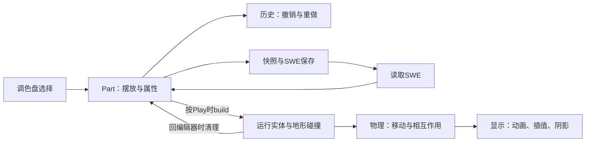

# 已实现功能是怎样工作的

这份说明面向项目负责人，解释当前分支已经实现的玩法和基础系统。
它回答五个问题：玩家看到什么、代码怎样处理、为什么这样分工、去哪找代码、
怎样检查。细节仍以对应代码和日期记录为准，不能把这里的概括当成完全复刻承诺。

当前主线是SMW风格。早期已实现的部分非SMM1内容保留，后续优先SMM1；
斜坡是你另外明确选择的例外。多个风格、所有社区关卡、在线服务都尚未完成。

## 1. 先理解整个工程

编辑器里摆放的对象叫Part，例如GoombaPart；试玩时真正移动和受击的
对象是Galoomba。它们承担不同工作，避免试玩时踩死一只怪物就把编辑中的
关卡也永久改掉。

| 名称 | 可以怎样理解 | 主要位置 |
|---|---|---|
| Level | 一次关卡会话，管编辑/试玩/通关、计时和重试 | `scripts/level/level.gd` |
| SubArea | 一个区域，持有布置、运行对象、背景和环境控制器 | `scripts/level/sub_area.gd` |
| Part | 编辑器中的物件描述，进入试玩时执行build | `scripts/level/parts/` |
| Entity / Tile | 运行时的怪物、道具、玩家、地形 | `scripts/level/entities/`、`tiles/` |
| State | 玩家当前行为，例如走路、跳跃、游泳、死亡 | `entities/states/` |
| Component | 能被不同对象复用的能力，例如拾取、重力、滑动 | `scripts/components/` |
| Resource | 可配置的数据，例如速度、变体、贴图名 | `resources/content/` |

这里的“区域”已经有架构位置，不代表水管/门切换副区域已经完成。

## 2. 放置、移动、删除、撤销

调色盘中的类别、页和物件由原项目的Palette资源组织。选择后，Editor
根据Part类创建编辑对象，Part负责格子对齐、占用检查和鼠标交互。
起始地面、斜坡、大型怪物、半穿透平台有各自的尺寸与边界规则，不能全都
用一个“单格空不空”判断代替。

EditorHistory把一次操作记成动作。移动需要保存前后位置，变体需要保存
前后类型及相关尺寸，连续绘制和拉伸则应整段撤销。删除后的对象有时还会
由历史记录保留，以便撤销恢复；清空历史时才释放不再需要的节点。

为什么不能每拖一帧记一次：那样一次拉伸会产生几十次Undo，也容易把大小
与位置恢复成不同时间的状态。入口：`scripts/ui/editor/editor_history.gd`、
`editor.gd`、`scripts/level/parts/part.gd`。
检查时要覆盖放置/移动/删除/连续绘制、一次Undo、Redo，以及离开编辑器。

## 3. 变体、翅膀、降落伞与内容物

支持变体的Part提供稳定ID与图标给原有EditorWindow，例如绿/红龟、不同
兄弟和三种半穿透平台外观。工具卡记住选项，之后放置的新对象使用该选择。
尺寸、附着方向等依赖状态要一起进入历史，防止只恢复名称而漏掉碰撞占用。

翅膀和降落伞是独立修饰，不把每种组合都复制成一个新怪物类。对应的
EnemyFlightProfile/Physics及EnemyFlightComponent决定跳跃、摆动、落地、
失去翅膀等行为；个别物种仍保留专用飞行规则。

能装东西的方块采用你纠正的拖入方式：把独立道具拖进去，历史同时记录
“外面对象消失”和“方块内容改变”。长按后查看或取出；取出也必须可Undo。
当前内容检查图标放大显示，避免只看到一个极小的原始像素图。

入口：`scripts/ui/editor/window.gd`、`top_panel/editor_card.gd`、
`parts/container_block_part.gd`、`components/enemy_flight_component.gd`。
可装内容与附件只覆盖已实现对象，不能推导为所有物件任意互装。

## 4. 关卡加载、保存与旧数据保留

SWE文件包含编码后的JSON与校验信息。LevelProcessor先检查并解码，再读
风格、主题、计时、地形、物件、平台等数据，创建编辑器Part。
目前同时处理旧MAIN字段和项目支持的新格式别名。

保存先在主线程读取编辑节点，形成普通Dictionary快照；工作线程再编码并
写文件，避免工作线程直接遍历正在被用户操作的编辑器。写入采用临时文件
及备份/恢复流程，成功后才更新活动路径和对象对应的源数据索引。

关键设计是保留源JSON。尚未实现的对象不会在试玩中自动得到行为，但保存
时仍尽量保留其记录与未知字段。删除并保存后，再Undo恢复的Part不能拿旧
索引覆盖另一个对象，因此Level还有保存修订号。

半穿透平台使用PLATAFORMAS/S7集合，普通物件使用NIVEL/S4集合，不能混写。
斜坡目前是项目扩展对象；原OpenWE程序能直接读懂该斜坡没有得到验证。

入口：`scripts/singletons/level_processor.gd`、
`scripts/level/swe_level_serializer.gd`、`ui/coursebot/level_action_btn.gd`。
验证包括两种封装往返、未知记录保留、多次保存、Undo跨保存、写入失败与
实际重新打开。多区域完整保存及原OpenWE可执行程序互通仍是缺口。

## 5. 为什么要转换贴图，而不是直接照搬GameMaker

SpriteLibrary读取本地生成的清单，取得每帧图像、原点、速度等信息，再创建
Godot的SpriteFrames。原点决定“这张图的脚/身体相对节点在哪里”，帧尺寸
相同不代表原点相同。奇数尺寸和大怪物旋转尤其容易暴露半像素中心错误。

清单未就绪时不能把“没有贴图”的临时结果永远缓存。这就是之前锤子兄弟
顶部图标消失的原因；当前冷启动使用回退，准备好后再生成实际图标。

入口：`scripts/singletons/sprite_library.gd`、
`tools/porting/prepare_slice.py`、`port_sprites.py`。转换输出位于被Git忽略的
`assets/openwe/`，因此其他人clone源码后还需要完成资源准备。
原始图像像素和转换产物的授权范围不是代码许可证自动解决的问题。

## 6. 马里奥走路、跑步、转向

移动由Player及当前State控制。每个物理步读取方向输入，按加速度改变水平
速度，再按走路/跑步上限限制；松键按减速度趋向零，反向输入则进入刹车。
速度不是按下方向键后立刻设置成固定值，所以会有起步与惯性。

参数从PlayerPhysics资源读取，统一换算成像素/秒、像素/秒平方。
例如78像素/秒在60Hz下约为每次物理步1.3像素。原GML中按帧写的加速度
换成按秒后需要乘3600，而非只乘60，否则手感会变。

走路转向与跑步刹车的画面分开判断：普通走路转向翻转贴图；完整跑步状态
反向才进入刹车姿势。烟尘用更低的速度阈值，所以走得较快时也能有烟。

入口：`entities/player.gd`、`entities/player_physics.gd`、
`entities/states/player_moving_state.gd`、`player_state.gd`。
检查起步、松键、低速/高速反向、持物反向和冰面，不能只检查最高速度。

## 7. 行走动画、脚底位置与成长

行走动画速度随实际水平速度变化，上限由PlayerAnimationRules限制；
它与角色每秒移动多少像素是两套参数。否则低速走路也会像快速踏步。
左右翻转围绕统一原点进行，不能让每一帧按不同边缘重新居中，否则会出现
只有一个马里奥却感觉左右抖动、重影的现象。

接地同时涉及碰撞体和贴图。碰撞体停在地面上；贴图按原点及显示偏移定位，
让鞋底与地面有你要求的1像素重合。编辑器静态怪物预览也使用相应基准，
不能只修试玩。倒挂或有自身脚部动画的对象保留专门的附着/姿态处理。

吃蘑菇后立刻使用大马里奥贴图，只改变其纵向缩放，经过24/20/26/20/28px
的站立视觉高度。脚的位置保持一致，期间不来回换小马里奥贴图。碰撞体
扩张另做头顶空间检查，空间不足时保持蹲姿，不能把身体强行顶入天花板。

入口：Player的`set_powerup_sprites()`、`set_powerup_hitbox()`、
`_update_sprite_origin()`，以及`powerups/powerup_animation.gd`。
验证应直接看不透明鞋底像素和身体坐标，不能只数一帧中有几个Sprite。

## 8. 跳跃、旋转跳、下蹲

普通跳的起跳速度随水平速度分档；上升时按住Jump使用较小重力，松开则
恢复正常重力，形成可控制的跳高。输入缓冲允许落地前很短时间的按键被
接收；土狼时间允许刚离开边缘时仍可起跳，两个窗口都很短。

旋转跳是独立State，使用自己的速度、动画和怪物接触规则。一些敌人会被
击败，一些例如刺类会让马里奥安全弹开，不能把所有接触都当成普通踩踏。
角落修正只在有限重叠范围推开身体，不应成为穿墙方法。

SMW的小/大马里奥都允许下蹲；贴图、碰撞体和持物偏移同步变化。站起前
检查上方空间，防止在低通道里恢复大碰撞体。入口：`entities/states/`、
Player的`_update_crouch()`与空间检查方法。测试同时覆盖按键时序与真实碰撞。

## 9. 刹车白云、接触闪光、星星粒子

刹车云由移动状态定时生成，位置留在生成处。跑步刹车使用独立间隔与较短
寿命，当前按你的最后指示不再跟脚，也减少了早期过密的数量。
每朵云经历放大、形状展开、缩小，不能只播放一个静态白块然后透明消失。
刹车声音使用专用播放节点，结束刹车、切状态和暂停成长时会停止。

旋转跳接触刺龟的闪光只使用一张白色图，再用连续缩放完成大小脉冲；
旋转跳击败怪物的四颗星各自移动、放大、缩小。位置变化和缩放不是同一件事。
入口：`scripts/other/skid_smoke.gd`、`spin_thump.gd`、`spin_smoke.gd`。
验证包括实际接触、粒子大小变化、结束清理及60/120fps显示。

## 10. 蘑菇、火焰花、星星、1UP

| 道具 | 当前实现流程 | 入口 |
|---|---|---|
| 蘑菇 | 独立移动道具或从砖内冒出，接触后把Small切为Super并播放成长暂停 | `entities/mushroom.gd`、`powerups/super_powerup.gd` |
| 火焰花 | 放置/砖内内容共用FireFlower；渐进内容会依据马里奥状态给蘑菇或花 | `entities/fire_flower.gd`、`parts/fire_flower_part.gd` |
| 火焰马里奥 | 同一Player身体换FirePowerup、火焰贴图和射击能力，受伤退到Super | `powerups/fire_powerup.gd` |
| 火球 | 独立PlayerFireball处理运动、弹地、墙面和敌人命中，区别于兄弟火球 | `entities/player_fireball.gd` |
| 无敌星 | 给现有形态叠加600物理步效果，拥有闪色、星屑、音乐和击败连分 | `entities/player_star.gd`、`super_star.gd` |
| 1UP | 冒出/移动/拾取与普通道具共享基础，增加会话内奖励数并播放反馈 | `entities/one_up.gd`、`sprouts/one_up_sprout.gd` |

再次吃星刷新时长；结束、死亡、通关和重试分别清理相关效果与音乐。
星星不替换Fire/Super，所以结束后仍保留原来的形态。1UP的完整档案/生命UI
尚未做，不能把会话计数当成全局生命系统。

## 11. 搬运、龟壳、头盔、冻结和震晕

PickupComponent管理谁持有物品、松手、向上扔、踢出及短时免碰撞。
持物对象会换父节点到Player，交接位置、图层和所有权必须一起处理。
最近修复了连续游泳状态中刚拿到道具的手部定位，避免只有切状态才更新。

龟壳分静止/移动等状态，负责反弹、顶砖、击败连分、被踢与扔出的区别。
龟脱壳后是另一个实体，达到恢复条件再进入壳。拿在手里的壳或扁栗宝宝
可以挡住一部分攻击，但不意味着接触任何敌人都无伤。

Buzzy/Spiny头盔由PlayerHelmet和HelmetRules描述，分别处理顶面、侧面、
抛射物、硬度和通关造型。它们不是把马里奥整体设为无敌。
冰兄弟的弹丸可让马里奥进入冻结状态；大锤兄弟落地可触发震晕及强制掉落。
对应State负责暂停普通动作、恢复、更新持物，并在死亡/退出时释放引用。

入口：`components/pickup_component.gd`、`player_helmet.gd`、
`entities/koopa_shell.gd`、`beach_koopa.gd`、`states/player_frozen_state.gd`、
`player_stunned_state.gd`。验证要包含持物中受击、连续拾取和状态中重试。

## 12. 怪物之间为何需要专门的接触系统

怪物与墙面使用Godot物理碰撞；怪物之间不少原版行为只是相遇转向或攻击
判定，不是把所有怪物变成相互推挤的刚体。

ActorContacts在每个物理步运动前记录可用对象的边界，按32px格子分桶。
需要接触检查的对象只查附近桶，再用实际边界判断；同一份快照也避免
“先更新的怪物已经移动、后更新的还没移动”造成顺序差异。

普通步行怪相遇转身；静止可搬运物阻挡一部分道具；飞行控制器和专用怪
保留自己的反应；扔出的扁栗宝宝和壳另走攻击规则。接触方法检查的是
具体搭配，不能把“有统一模块”理解成所有组合均已完成。

入口：`scripts/level/actor_contacts.gd`、`entities/enemies/enemy.gd`。
验证双方运动顺序、静止/移动/持有状态、重复命中和重新进入试玩。

## 13. 当前每类怪物的实现

下面的变体通常由`resources/content/`提供参数，Part管编辑器，运行类管AI。
“有反应入口”不等于产生该反应的全部新物件都已实现，例如有POW受击规则
并不能据此说编辑器的完整POW系统已完成。

| 怪物/变体 | 怎样实现与主要差别 | 运行入口 |
|---|---|---|
| SMW栗宝宝、Goombud | 步行、踩扁后可搬运与恢复；Goombud额外避开边缘 | `entities/enemies/galoomba.gd`、`stomped_galoomba.gd` |
| 绿/红龟 | 共用龟与壳生命周期，变体参数决定边缘行为等；踩后壳与脱壳龟分工 | `entities/enemies/koopa.gd`、`koopa_shell.gd` |
| 钢盔龟/空壳 | 占壳、空壳、倒挂掉落、恢复分状态；带翼形态有专用可站立运动 | `entities/enemies/buzzy_beetle.gd` |
| 刺龟/刺壳 | 刺和壳接触规则独立，顶砖翻转后可恢复；带翼形态按时钟交替发针 | `entities/enemies/spiny.gd`、`spiny_needle.gd` |
| 鱿鱼 | 喷射上升与下沉阶段交替，水中/空气状态和击败漂浮单独处理 | `entities/enemies/blooper.gd`、`blooper_rules.gd` |
| 红/黄鱼 | 共用控制器，参数决定游动、跃起、滑翔、摆动及附件；液体死亡有专用表现 | `entities/enemies/cheep_cheep.gd`、`cheep_cheep_variant.gd` |
| 跳跃/吐火食人花 | 依环境拓扑决定附着朝向，运行时按阶段跳出或瞄准发射；弹丸独立 | `entities/enemies/piranha_plant.gd`、`plant_fireball.gd` |
| 小/大黑色吞噬花 | 刚性障碍、堆叠、压碎和翻起规则；大尺寸有更大占用与落地反馈 | `entities/muncher.gd`、`muncher_variant.gd` |
| 小/大咚咚 | 等待、攻击、撞击、返回有独立时钟，方向/尺寸影响检测与顶砖 | `entities/thwomp.gd`、`thwomp_variant.gd` |
| 鼹鼠 | 分时追踪马里奥，遇墙反向跳，水中和带翼运动使用自己的参数 | `entities/monty.gd`、`monty_variant.gd` |
| 扳手鼹鼠 | 等待、冒出、准备、扔出、缩回循环；支撑丢失和水中状态单独处理 | `entities/rocky.gd`、`rocky_variant.gd` |
| 扳手 | 生成后按重力轨迹飞行，拥有动画、碰撞、闪烁和到期清理 | `entities/wrench.gd`、`wrench_rules.gd` |
| 锤/火/冰/回旋镖兄弟 | 同一兄弟控制器按变体选择巡逻、平台跳与连投；每种投射物仍有专用物理 | `entities/hammer_bro.gd`、`bro_projectile.gd` |
| 大锤兄弟 | 更大尺寸、落地震晕、烟尘/音效；翅膀和降落伞有专门阶段 | `entities/hammer_bro.gd`、`hammer_bro_variant.gd` |
| 自由汪汪：小/大 | 椭圆头部、跳跃及连带显示按来源规则；尺寸影响占用与碰撞 | `entities/chain_chomp.gd`、`chomp_variant.gd` |
| 滚石：旧/新小/新大 | 旋转滚动、弹跳和边界规则由变体区分，较大类型有更大编辑占用 | `entities/grrrol.gd`、`grrrol_variant.gd` |

自由汪汪尚没有完整桩、拴链与挣脱系统。兄弟的非SMM1类型、滚石、降落伞
等属于早期已完成内容，现阶段不继续扩充这些方向。

## 14. 怪物碰撞、击败、液体与屏外暂停

有些身体是矩形，有些需要椭圆或精确贴图遮罩。统一拿一张外接矩形去撞
会导致隔空顶头、透明角落也伤人；因此SpriteCollision、各物种的mask数据
及头盔规则保留了差别。移动快的接触还需要检查上一位置到本次位置。

普通踩、旋转踩、壳、火球、持物、顶砖对怪物的作用不同。敌人通过相应
受击入口决定能否击败、失去翅膀、翻转或反弹，再创建正确的尸体/特效。
尸体的原点、朝向、初速度、旋转、水中表现与活体不一定相同。

ActorActivity按屏幕附近的活动带管理部分对象的暂停与恢复，避免全图AI
一直更新；弹丸、独立效果和死亡状态仍有各自规则。WorldDeath统一协调
马里奥死亡期间哪些运动/时钟继续，防止简单暂停一切破坏原版表现。

入口：`entities/sprite_collision.gd`、`scripts/level/actor_activity.gd`、
`world_death.gd`、`scripts/other/`。验证除了“踩一下”还要看透明边缘、
持有/飞行/液体状态、屏外恢复、死亡重试和延迟创建对象的清理。

## 15. 金币、问号砖、硬砖、隐藏砖、转转砖

金币由接触触发收集反馈和计数，砖内金币通过Sprout效果释放。问号砖记录
是否已使用与内容物，内容不只是图标：顶出时创建相应道具并交给区域管理。
连续金币有来源规定的计时窗口，不等于每个方块永远只出一枚金币。

隐藏砖平时隐藏并按对应接触方向触发；硬砖处理碰撞、破坏与碎片；SMW
转转砖的转动阶段和恢复碰撞由自己的Tile维护。内容释放和延迟破坏由砖
拥有，离开关卡时一起取消，避免下一次试玩收到上一次的道具。

入口：`parts/container_block_part.gd`、`tiles/question_block.gd`、
`hidden_block.gd`、`hard_block.gd`、`turn_block_tile.gd`、`sprouts/`。
检查小/大马里奥顶砖、可搬运物顶砖、内容历史、多金币和中途退出。

## 16. 地形连接、开始地板、六种场景主题

普通地面继续使用GodotWE原有的53种图集选择规则，依据邻格是否有地面
决定边、角、内部等贴图。开始地板与后来放置的地面共享占用图，因此接缝
可以连起来；不是把两块各自封边的图强行贴在一起。

为避免拖斜坡时全部草地乱变，装饰变体由坐标稳定选择。相同格子在没有
改变邻接关系时保持选择，局部刷新也利用缓存。

主题切换支持地上、地下、水下、鬼屋、飞船、城堡六种SMW日间环境。
切换会刷新背景、地面、已有支持物件、预览、音乐及液体状态；撤销也要
恢复整组设置。菜单使用场景卡片、原项目红色边角选中效果，不显示名称标签。

不同主题的源图片帧顺序不能拿SWE的保存帧索引直接套用。当前适配表区分
原图“填满、孤立、竖条、横条”等角色，再让原有连接规则选图，修正了
你报告的主题切换地面损坏。

入口：`parts/ground_part.gd`、`starting_ground.gd`、`scripts/level/smw_theme.gd`、
`ui/editor/left_panel/level_theme_panel.gd`、`resources/content/smw_ground_frames.json`。
这不是门/水管进入另一区域的切换，也不包含所有SMM2主题。

## 17. 斜坡：形状、合并、拉伸

斜坡由端点、方向和陡/缓属性描述。编辑器保存的是一条有厚度的斜面带，
不是一个填满的大三角形；物理使用相应多边形，而不是一排台阶碰撞体。
拉端点改变长度，碰撞检查用实际带形范围，不能把整个外接矩形都封死。

真正接触斜坡的地面连通块会在斜坡覆盖范围内派生填充及轮廓，形成自然
连接；独立悬空地块不应激活合并。派生图形/碰撞可重新计算，原始地块
记录仍在，因此移动或Undo后可以恢复原来的地形。

陡/缓表面、端头与普通土壤有不同贴图职责。自绘PNG通过
`textures/tiles/slopes/README.md`约定的尺寸和主题名称接入；未提供的
缓坡素材仍有临时采样回退，不能把回退当成完整原版素材。

入口：`parts/slope_part.gd`、`gentle_slope_part.gd`、`tiles/slope_body.gd`。
验证两方向、短/长与5x5/6x6、深凹地形融合、怪物间隙、Undo、实际鞋底像素。
当前斜坡的SWE对象是项目扩展，天花板斜坡和其余样式仍未完成。

## 18. 尖刺、冰块、云、甜甜圈、音符、弹簧

| 物件 | 实现方式与容易弄错的地方 | 入口 |
|---|---|---|
| 尖刺 | 实体危险地形；动画按共享时钟6fps采样，不按资源的60fps自动连播 | `tiles/spike_tile.gd` |
| 冰块 | 有实体碰撞/破坏；玩家仅在脚下支撑为冰面时采用冰面加减速 | `tiles/ice_block.gd`、Player的`is_on_ice()` |
| 云平台 | 薄的单向顶部，下方可穿过；有独立的咚咚压碎反应 | `tiles/cloud_platform.gd` |
| 甜甜圈 | 站立警告、抖动、下落和重置分阶段；移动平台负责带动乘客 | `tiles/donut_platform.gd` |
| 音符砖 | 压缩后按普通/高跳/旋转跳释放乘客，砖内道具按砖拥有的时钟弹出 | `tiles/note_block.gd`、`states/player_note_state.gd` |
| 普通弹簧 | 可搬运/放下，压缩四帧后一次性发放弹速，玩家与普通怪物均有响应 | `entities/spring.gd`、`states/player_spring_state.gd` |

弹簧压缩贴图的顶面以离散像素跳动，显示插值必须让脚跟着可见顶面，
否则身体碰撞正确也会看起来浮起。横向/带翼弹簧、音符音乐变体未完成。

## 19. 普通半穿透平台

平台保存宽高和三种外观之一，最小3x3格；右上角拉伸时左下角不动，
所以改变高度也必须改变顶部位置，二者一起进历史。尺寸还有房间边界。

外观由12个原始图块组成：顶边、底边、中部各有位置规则，中间装饰还有
奇偶交替。源规则每画一格翻转一次、每画完一行再翻转一次，因此偶数宽
不能简单用“第几行奇偶”来选图。图像合成结果有缓存上限，防止无限增长。

下面的装饰允许与地面、怪物、别的平台重叠，不占用普通单格放置空间；
真正的碰撞只有顶部5px单向表面，从下面上跳能穿过，下落才站住。
背景平台不应抢前面怪物的鼠标拖拽。右上角使用原有动画手柄。

画面排序也很重要：当前平台在背景/阴影之上、前景物件之下；同层再按
顶部高度排序。此前直接把源深度算成很小的Godot z值，会让平台画到自身
阴影下面变暗，真实GPU检查发现后已修正。

入口：`parts/semisolid_part.gd`、`scenes/parts/semisolid_part.tscn`。
验证放置/拉伸/外观/撤销、两种保存集合、奇偶宽全部主题、真实穿过/落地、
怪物和蘑菇站立、重叠后移动排序及60/120fps画面。

## 20. 水面、岩浆/毒液与马里奥游泳

LiquidSurface根据区域设置维护表面位置和升降/停留阶段，使用主题对应
表面动画。实体分别判断自己怎样受液体影响：游泳、下沉、漂浮或死亡。
所有对象共享一个水位，不等于共享一种水中运动。

马里奥进入水体后切到PlayerSwimmingState。空手按Jump划水，下沉时和
已经上升时的冲量不同；无输入时有浮沉上限。水底仍可走、蹲和划水离地。
拿着物品会有被动浮力和前向漂移，按Down可反向下潜；持物不是只换一张图。

水面进入/离开使用略有差别的高度阈值，防止同一位置反复切状态。
按住Jump出水后交回普通跳跃状态，恢复空气重力。冻结、震晕、死亡、
通关等高优先级状态不能被“检测到水”随便替换。小/Super/Fire均使用
对应的原始游泳/漂浮图，气泡有自己的生成间隔与运动路径。

入口：`scripts/level/liquid_surface.gd`、`liquid_rules.gd`、
`entities/states/player_swimming_state.gd`、`player_swim_rules.gd`、
`scripts/other/player_bubble.gd`。测试还覆盖持物交接、出入水、受击和重试。

## 21. 通关、计时、死亡与重试

Level管理剩余时间与会话状态。SMW终点门接触后进入专用通关流程：
停止普通操控，自动行走，播放结束音乐，结算时间/分数，展示姿势并退出。
它不是在屏幕中央放一个测试用的半透明完成面板。

死亡也不是只隐藏马里奥。PlayerDeathState/WorldDeath控制短暂停顿、
死亡运动、哪些场景对象继续运动、声音，以及何时重试。重试和返回编辑器
清除运行时实体、延迟冒出的道具、尸体、粒子、音乐与相机显示偏移。

入口：`scripts/level/smw_goal_sequence.gd`、`tiles/goal_gate.gd`、
`entities/states/player_goal_state.gd`、`player_death_state.gd`、`world_death.gd`。
城堡等完整不同结尾、终点高度全部奖励、完整档案系统仍不是已完成范围。

## 22. 为什么120fps更顺，物理却仍然是60Hz

物理每秒60次更新，显示器可能每秒显示120次。如果每次渲染都直接画最近
一次物理位置，相邻两张图会相同，移动看起来有停顿。WorldPresentation
保存前后两个已完成物理步的位置，按照显示时刻在它们之间插值。

例：两次物理位置是100和103，显示中间帧可画101.5。碰撞仍然使用物理
位置，画面101.5不会偷偷变成一个新的碰撞位置。相机、角色、背景要共享
显示时间，否则角色顺了，背景仍会跳。传送/重试等大位移会重置插值。

贴图翻转、成长挤压等当前姿态不按两个方向混合；暂停期间也要固定正确
画面。阴影和像素测试必须读取相同的显示变换，不能只看节点物理坐标。
这改善运动呈现，但不等于输入延迟、所有机器性能或原版手感都已相同。

入口：`scripts/level/world_presentation.gd`、`background.gd`、
`scripts/singletons/utility.gd`。既有测量与限制见SMOOTHNESS记录。

## 23. 右下像素投影与旋转锯齿

PixelShadows按当前帧的角色/物件轮廓，在右下方绘制偏移投影，并把重叠
轮廓合成为统一透明度，避免多个阴影叠起来越来越黑。会跳过编辑器手柄
等辅助图形；命令缓存和屏外跳过减少重复处理。

像素贴图旋转后，原来整齐的像素格不再对齐屏幕，最近邻采样会出现边缘
跳变。已有的可选旋转采样只针对需要的旋转对象处理边缘，保留原始贴图
与不旋转时的清晰像素。它不能让低分辨率画面在所有角度都没有锯齿。

入口：`scripts/level/pixel_shadows.gd`、`shaders/`、相关实体的采样设置。
检查当前帧轮廓、透明边、翻转/缩放、重叠阴影、水平/竖直角度和中间角度。

## 24. 声音、菜单与启动流程

背景音乐、UI音效、对象音效各有管理入口。星星、通关和死亡暂时接管音乐
时，需要记录恢复条件；刹车声不能占用所有玩家音效共用的一条播放通道。
切回编辑器与重试必须结束旧会话的循环音。

启动沿用原项目的声明、介绍、标题、编辑/试玩入口。EditorPlayer可能先
进入树，稍后才得到Level，所以处理输入前检查有效上下文，退出时也检查
对象是否已被释放；这是之前启动报错的修复点。Coursebot的Edit/Play复用
同一套加载入口，避免各自造出不同的Level。

入口：`scripts/singletons/music_player.gd`、`ui_sound_player.gd`、
`parts/editor_player.gd`、`ui/coursebot/`、`ui/editor/left_panel/`。
已有菜单框架不代表账号、服务器、完整关卡分享服务已经接入。

## 25. 怎么证明功能可靠，怎么回应审查

验证分三层：纯规则/资源数据检查；真正创建场景、执行输入和碰撞的原生
测试；真实渲染后读取像素或录制对照。只调用一个函数并检查返回值，
不能证明实际画面正确；只看截图也不能证明保存与Undo没有丢数据。

目前最近一次完整功能回归记录有57个原生场景。它证明的是这些场景覆盖
的条件，不是“所有代码都符合规范”或“所有社区关卡都兼容”。
格式检查、公开接口注释、来源说明、干净环境运行和维护者审查仍需分别做。

你向维护者解释一个功能时，可以按下面顺序：

1. 原版/用户要求是什么；哪些是目前刻意没有实现的部分。
2. 编辑器Part保存什么数据，运行实体在哪创建，谁拥有它的生命周期。
3. 行为在哪个State/Component里，参数单位是什么，为什么需要例外。
4. 具体改了哪些文件，会影响哪些旧功能；测试覆盖了哪些触发条件。
5. 当前已知限制、可复现问题和待审查的取舍。

以后新增或修改功能，都应同步这五项。遇到不懂的代码，应回到对应章节、
入口函数和实际运行结果逐步验证，而不是只用“测试通过”代替解释。

## 26. 当前还没有完成的事情

其余游戏风格与内容全量覆盖、全部物件的附件/内容组合、管道/门副区域
传送、关卡检查点及完整条件系统、完整档案/生命/在线社区服务、各主题
全部自绘斜坡素材、完整结尾与真实社区关卡大规模兼容验证，都仍有缺口。

现有代码也有规范整理债务。第一批7文件的格式/公开注释检查不能替代全库
合规结论；剩余部分要逐批整理，入口见STRUCTURE-REVIEW及当前HANDOFF。
