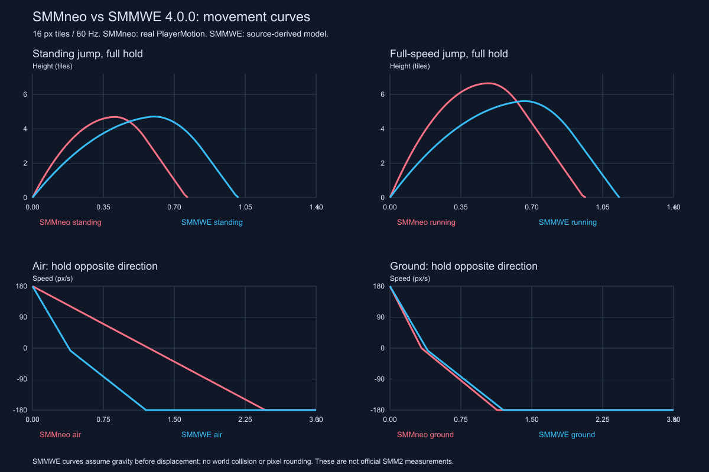

# SMMWE 4.0.0 物理与操控研究

日期：2026-10-08。Codex 负责源码追踪、数值模型和最终核验；Antigravity Gemini 3.8 Flash Medium 负责独立的参数与输入审查。

后续状态：负责人已要求将默认运动同步为 SMMWE 参考。本文“当前 SMMneo”和图表保留**同步前**的研究快照，原始 JSON/曲线不覆盖；现在的实现与核验见 [同步记录](../plans/2026-10-08-smmwe-physics-sync.md)。旧曲线可用 `pre_smmwe_physics.tres` 复现。

## 结论先读

当前 SMMneo 的跑速和地面加速度已经接近该 SMMWE 版本，主要差异在 **空中反向响应、跳跃时间曲线、短跳高度和满速跳增益**。因此，“手感奇怪”不能只靠改最高跑速解决。

- **空中反向明显更弱**：SMMneo 从 +180 px/s 按反向到速度过零需要 74 帧；SMMWE 普通运动源码模型为 24 帧。当前从满速起跳后，即使立即在空中反向，通常也来不及在同高落地前完成换向。
- **原地长跳高度接近，时间不同**：约 4.69 格对约 4.71 格，但当前 24 帧到最高点，SMMWE 模型为 36 帧；当前更快向上冲，也更快掉回地面。
- **满速跳增高过大**：当前约 6.65 格，SMMWE 模型约 5.61 格；当前的跑跳比原地跳多约 1.96 格，对照只多约 0.90 格。
- **点按短跳偏高**：按住 1 帧再释放，当前原地约 2.44 格，对照约 1.67 格。不能只压低长跳高度，还需要保留长短跳差别。
- **跑姿、步频和刹车表现也不同**：SMMWE 的 P-Meter 控制部分表现，行走/跑步帧速上限 18 fps；当前按速度达到上限切跑姿，180 px/s 时为 15 fps，84 px/s 时为 7 fps。

上述差异与源码一致，可以解释可能的感受；**尚未通过两款游戏的人工 A/B 试玩确认**。SMMWE 模型计算也不是原版 SMM2 测量。



红线来自当前真实 PlayerMotion 的数值运行；蓝线来自 SMMWE 普通 Mario 分支的独立离散模型。底部空中换向图假设角色持续在空中，用于比较控制力，不代表实际腾空 3 秒。

## 来源、版本和证据等级

负责人提供的 [GitHub 仓库](https://github.com/arichornlover/SMMWE-SourceCode)只有 README 下载索引。选用其中最新列出的 [SMMWE 4.0.0 ZIP](https://drive.google.com/file/d/1Uv6Fqpp5eXy70mPek1QIxEL2ipoh4vuq/view)，下载日期 2026-10-08。

| 项目 | 本次记录 |
|---|---|
| 下载文件 | 本地名 `SMM_WE_4.0.0.zip`；Drive 展示名 `SMM_WE 4.0.0.zip` |
| 字节数 | 252,000,276 |
| SHA-256 | `ce2b957af1e1efe68c678d0c38895d325a61a5852212e1feb52e43abdeb9c528` |
| 包内工程 | `SMM_WE-HD-main/SMM_WE-HD/SMM_WE.yyp` |
| 提取 | 11,821 份文本，35,715,642 字节；每份提取文本通过 ZIP CRC 校验 |
| 基本帧率 | `options/main/options_main.yy:7`：60 Hz；本次未发现 GML 动态修改 room_speed/game_set_speed |
| 格子大小 | `objects/obj_ground/Create_0.gml:2`：`move_snap(32,32)` |
| 研究主范围 | `obj_mario`：SMB1、SMB3、SMW 共用的普通陆地/空中分支；详细比较以 SMW 白天、普通形态、无冰雪/星/搬运/骑乘为前提 |
| 版本限制 | “4.0.0”来自下载索引与文件名；包内目录明确含 HD。不能未经运行就认定它与其他 SMMWE 4.0.0 发布构建完全相同 |

**源码确认**指字面数值、条件和顺序；**模型计算**指按这些规则独立复现的数值；**原生数值运行**指 Godot 直接执行当前 PlayerMotion，但使用合成平地，不调用真实碰撞场景；**实际试玩**本次未完成。没有参数被提升为 SMM2 VERIFIED 或负责人 TUNED。

原 ZIP、原样文本、完整哈希清单、原生运行日志保存在 `local_debug_output/smmwe-research/`；研究结果与复现工具保存在本工程 docs/tools 下，没有复制媒体进 gameplay。

## 单位换算：32px 格子到 16px 格子

[GameMaker 官方 hspeed 文档](https://manual.gamemaker.io/lts/en/GameMaker_Language/GML_Reference/Asset_Management/Instances/Instance_Variables/hspeed.htm)和 [vspeed 文档](https://manual.gamemaker.io/lts/en/GameMaker_Language/GML_Reference/Asset_Management/Instances/Instance_Variables/vspeed.htm)说明这两个内置量按每 step 的像素位移计量。

- 速度：`SMMWE px/step × 60 × (16/32) = SMMneo px/s`，乘数为 30。
- 每帧速度增量/重力：`SMMWE px/step² × 60² × (16/32) = SMMneo px/s²`，乘数为 1800。
- 距离：SMMWE 像素乘 0.5，或直接除以 32 得到格数；时间：帧数除以 60。

例如 `hspeed=6` 对应 180 px/s，不是 360 px/s；`gravity=0.2` 对应 360 px/s²，不是 720 px/s²。这个尺度只用于本包普通 `obj_mario` 分支；另一个 `obj_marioU` 的数值体系单独列在后文。

## 完整普通运动参数对照

SMMWE 路径下列 `Other_12` 均指 `objects/obj_mario/Other_12.gml`。当前参数来自 [base_physics.tres](../../data/physics/base_physics.tres)，算法来自 [PlayerMotion](../../src/gameplay/player/player_motion.gd) 与 [PlayerPhysicsProfile](../../src/gameplay/player/player_physics_profile.gd)。

| 参数/行为 | SMMWE 原值与条件 | 换算到 16px 尺度 | 当前 SMMneo | 主要源码依据 |
|---|---|---|---|---|
| 行走上限门槛 | 2.6 px/step | 78 px/s | 84 px/s | Other_12:95–105 |
| 跑步上限门槛 | 6 px/step，跑键或 key_br | 180 px/s | 180 px/s | Other_12:95–105 |
| 地面同向加速 | 0.12/step | 216 px/s² | 225 px/s² | Other_12:304–318、331–345 |
| 地面反向减速 | 0.14 + 0.12/step | 468 px/s² | 540 px/s²，先钳到零 | 同上 |
| 空中同向加速 | 0.12/step | 216 px/s² | 146.25 px/s²（225×0.65） | 同上；普通加速不区分地面/空中 |
| 空中反向加速 | 0.26/step，允许一步跨零 | 468 px/s² | 146.25 px/s² | 同上 |
| 地面松方向摩擦 | 0.10/step，低于 0.10 归零 | 180 px/s² | 225 px/s² | Other_12:351–371 |
| 地面蹲滑摩擦 | 0.10/step | 180 px/s² | 225 px/s² | Other_12:274–294 |
| 地面超速回落 | 0.05/step，额外分支 | 90 px/s² | 225 px/s² | Other_12:372–380 |
| 空中松方向 | 无摩擦；同向已超过当前上限不强制压低 | 0 | 0；保留超速动量 | Other_12:351、372；PlayerMotion._update_horizontal |
| 普通慢速起跳 | -7.9，`round(hspeed/2)==0` | -237 px/s | -360 px/s | Other_12:106–155 |
| 普通行进起跳 | -8.1，超过慢速档但未超过 5.6 | -243 px/s | 从 -360 到 -430 连续插值；低于 walk_max 都是 -360 | 同上 |
| 普通高速起跳 | -8.6，`abs(hspeed)>5.6` | -258 px/s，门槛 >168 px/s | 满速 -430 px/s | 同上 |
| SMW 旋转起跳 | -6.6，并 `y--` | -198 px/s，额外抬升 0.5px | -280 px/s，无独立 y-- | Other_12:156–209 |
| 长按上升重力 | 0.2；jumpnow=1 且 vspeed≤-1 | 360 px/s² | 900 px/s²；vy<0 即可 | Other_12:382–428 |
| 松键/近顶点/下落重力 | 0.6；松键或 vspeed>-1，锁存 jumpnow=2 | 1080 px/s²；顶点切换门槛 vy>-30 px/s | 1800 px/s²；vy≥0 或松键锁存 | 同上 |
| 下落限速字面值 | 8，先在脚本钳制，再交给内置重力 | 240 px/s 的脚本门槛 | 270 px/s，重力更新后钳制 | Other_12:25–37；PlayerMotion.begin_tick |
| 离地宽限 | statedelay>4 才 state=2，且要求 jumpnow=0 | 普通走出平台最多 4 个候选 step | 配置 6 帧 | Other_12:1–23、106；需结合碰撞状态 |
| 起跳输入缓冲 | 普通分支直接消费 keyboard_check_pressed，未找到常规缓冲计数 | 无可证明的多帧普通缓冲 | 配置 5 帧 | Other_12:106、156、210；PlayerMotion.queue_jump/finish_tick |

SMMWE 的 hspeedmax 是加速分支门槛，并非精确硬上限：例如地面 2.59 下一帧 +0.12、再减 0.05，可到 2.66；下一帧继续回落。空中也可能一次超过门槛后保持。不能将其称为每帧精确锁定的 78/180。

下落限速也存在顺序差别：在本模型的“内置重力先加速度再位移”假设下，脚本钳到 8 后再 +0.6，实际移动可用 8.6，即 258 px/s。**240 是确定的脚本阈值，258 是待 GameMaker 运行核验的模型结果**，不把两者混用。

## 从每帧逻辑理解手感

### 水平：地面相近，空中换向差很多

SMMWE 普通方向输入的一帧会先检查原速度方向。若相反，先加 0.14，再无条件加 0.12；因此反向不是 0.14，也不是仍用 0.12。普通空中同样走这条路径。SMMneo 地面使用专门 skid_decel，空中则统一使用 ground_accel×air_accel_factor，没有独立的空中反向力。

| 可观察动作 | 当前真实 PlayerMotion 数值运行 | SMMWE 源码模型 |
|---|---|---|
| 静止按跑和方向到上限 | 48 帧 / 0.800s；约 4.59 格 | 约 50 帧 / 0.833s；约 4.78 格 |
| 满速松方向，跑键保持 | 48 帧 / 0.800s；滑约 4.41 格 | 60 帧 / 1.000s；滑约 5.53 格 |
| 满速在地面按反向到过零 | 20 帧 / 0.333s | 24 帧 / 0.400s |
| 满速在空中按反向到过零 | 74 帧 / 1.233s | 24 帧 / 0.400s |
| 地面松跑键但保持同向，从跑速到走速 | 26 帧 / 0.433s | 模型 68 帧 / 1.133s，从 6 减到 2.6 |

表格区分“松方向”和“只松跑键”；它们在 SMMWE 的减速逻辑不同。SMMWE 的更长地面滑行并不支持“当前一定是地面摩擦不足”的诊断。空中较弱的反向力则有清楚的数值证据。

### 跳跃：同样高度可以有完全不同的节奏

SMMWE 普通起跳按起跳前水平速度分三档；当前则先更新本帧水平速度，再按 walk_max 到 run_max 连续插值。SMMWE 在 vy>-30 px/s 时提前切换大重力并锁定；当前在 vy≥0 才切换。当前起跳帧还跳过一次重力积分，SMMWE 起跳事件没有对应的显式跳过标志。

以下是合成同高平地的离散计算；SMMWE 尚未在 GameMaker 中执行，不能把帧数当作发布版逐帧实测。按住 1 帧即在第 2 帧释放；“长按”保持到落地。

| 起跳条件 | 当前高度 / 到顶点 / 腾空 | SMMWE 模型高度 / 到顶点 / 腾空 |
|---|---|---|
| 原地，按 1 帧 | 2.44 格 / 12 帧 / 26 帧 | 1.67 格 / 13 帧 / 27 帧 |
| 原地，按 6 帧 | 3.28 格 / 15 帧 / 32 帧 | 2.42 格 / 17 帧 / 33 帧 |
| 原地，按 12 帧 | 4.03 格 / 18 帧 / 37 帧 | 3.18 格 / 21 帧 / 40 帧 |
| 原地，长按 | 4.69 格 / 24 帧 / 46 帧 | 4.71 格 / 36 帧 / 61 帧 |
| 行走，长按 | 4.69 格 / 24 帧 / 46 帧 | 4.96 格 / 37 帧 / 63 帧 |
| 满速，按 1 帧 | 3.44 格 / 15 帧 / 32 帧 | 1.97 格 / 14 帧 / 29 帧 |
| 满速，长按 | 6.65 格 / 29 帧 / 58 帧 | 5.61 格 / 40 帧 / 68 帧 |
| SMW 旋跳，长按 | 2.87 格 / 19 帧 / 35 帧 | 3.27 格 / 30 帧 / 50 帧，未含 y-- |

如果把 SMMWE 模型换成“先位移、后加重力”，原地长跳会变为约 4.96 格、37 帧到顶点、64 帧腾空，满速约 5.88 格、41/72 帧。这个敏感性结果保存在 metrics.json，说明运行时顺序的核验价值；它不改变当前空中换向显著较弱、上升显著更快的判断。

### 输入、蹲跳和朝向

- 左右同时按下时，SMMWE 方向条件互斥：地面走松键摩擦分支，空中保持水平速度。当前 Input.get_axis 的键盘动作净值也为零。
- 普通跳需要按下边沿、disablecontrols=0、jumpnow=0、state<2；不能只按住跳键自动连跳。普通输入分支未保存落地前几帧的跳跃请求。PlayerMotion 则保存 5 帧缓冲，并在碰撞落地后消费。
- SMMWE 普通跳或旋跳任一键的释放都可将 jumpnow 从 1 改为 2；未按“本次起跳的键”区分。因此两键混用有边界差异。当前明确记住起跳来源，仅由对应键释放控制长短跳。
- SMMWE 蹲跳中，在下落且松下键、头顶检查允许时可解除蹲姿（Step_0:385–392）。当前按负责人已确认设计，将 crouch_jump 保持到落地。此处是既有玩法选择，不因对照不同就判作 bug。
- SMB1 普通空中输入常保留原朝向，SMB3/SMW 可以在空中转脸（Other_12:320、347）。当前普通方向输入立即更新 facing；跨风格扩展时需要分别处理。
- 手柄由 obj_persistent/Step_0.gml 将按钮/轴状态模拟成键盘输入；Android 的 key_br 在关卡管理器 End Step 中切换跑键锁存。它们可能产生事件顺序上的一帧差异，本次未实测设备延迟，未发现普通跳的显式多帧缓冲。

### P-Meter 与动画：参考中存在，不能照搬为当前设计

SMMWE 的计数所有者是 `obj_levelmanager`；Mario 在 End Step 同步 pmeter（Step_2:3–4）。普通 SMW 地面 state=1 且 abs(hspeed)>2.1 时，每次 Alarm 7 加一点，不要求按跑键。这意味着普通走路也可能充槽。

初始 Alarm 7 等待 15 帧，未满时每 8 帧再次触发；满槽为 6，之后 Alarm 9 每 7 帧让 6/7 来回切换。第一笔成功充能到第六笔跨度是 40 帧，实际从开始移动到满槽还取决于初始 15 帧、当前定时器相位和速度门槛，不能固定称为 48 帧。未满足条件时 slowdown 每三次 Alarm 才扣一点；满槽使用 300/100 帧保留计时，并在地面速度低于门槛、未 skid 时回到 5。

- 普通地面跑姿和刹车贴图/循环音效常要求 pmeter>5（Step_2:66–77、237–253）。这并不改变普通 hspeedmax=6 或三档普通起跳初速。
- 普通空中跑跳姿态也检查当前 pmeter（Step_2:410 及后续分支），不是当前 jump_kind 的起跳锁存。
- 普通行走/跑步 image_speed=min(abs(hspeed/5),0.3)（Step_2:237–241），即每秒最多切 18 帧；小型 SMW walk/run 都是两帧。当前按实际水平位移/12px 累积动画相位，180px/s 为 15fps，84px/s 为 7fps。
- SMMWE Draw 会 round(x/y) 进行像素取整，而物理坐标仍可为小数（Draw_0:10）。当前动画和相机呈现应单独检查；视觉运动不完全等于数值速度。

负责人已经确认当前“速度达到 run_max 才切跑姿”“满速跳姿态直到落地”“P-Meter 不作为普通速度或跳高门槛”。本研究没有推翻这些选择。

## 碰撞与落地：数值之外的触感

[GameMaker 官方事件顺序](https://manual.gamemaker.io/lts/en/The_Asset_Editors/Object_Properties/Event_Order.htm)说明 Step 之后进行自动移动和碰撞，再执行 End Step。本包开启 option_collision_compatibility；其实体还使用大量主动 collision_rectangle 检查，因此不能直接以 Godot 的 move_and_slide 代替后就宣称等价。

SMMWE 主路径：Step_0 先预测脚底到 bbox_bottom+vspeed 的平台碰撞，满足条件时直接对齐平台、vspeed/gravity=0、重置起跳状态；再执行坡面修正；普通移动调用 event_user(2)，也就是 Other_12；随后做头部/左右检查；引擎自动移动/碰撞；End Step 决定掩码、动画、pmeter 表现。当前 Player 则先刷新形状、更新运动、尝试擦角纠偏、move_and_slide，再处理顶头/落地和缓冲跳。

| 项目 | SMMWE 源码证据 | 当前 SMMneo |
|---|---|---|
| 小型掩码声明边界 | 24×30 → 12×15；spr_smallmask.yy:13–16 | 12×14 矩形 |
| 大型掩码声明边界 | 24×54 → 12×27；spr_bigmask.yy:13–16 | 12×28 矩形 |
| 小型下蹲声明边界 | 24×26 → 12×13；spr_smallduckmask.yy:13–16 | 12×14 |
| 大型下蹲 | 使用 spr_smallmask → 12×15；Step_2:821–837 的掩码分支 | 12×14 |
| 顶头 | 多组 bbox 顶部检查，vspeed=0；Step_0:225–331 | 顶头后 vy=10px/s，另选顶块 |
| 擦角纠偏 | 普通主路径未见与当前等价的 1–3px 横移扫描；侧面逐像素推出 | 上升时扫描至 3px，优先运动方向 |
| 坡面贴地 | slope_collision 主动下嵌 4px、取整并向上推出 | floor_snap=2px，floor_constant_speed=true |
| 离地窗口 | statedelay 延迟切 AIR，不能脱离碰撞分支保证固定 4 帧 | 独立 coyote_left 计数 |

这里的掩码尺寸是 yy 声明的包围边界，未运行 GameMaker 精细碰撞掩码；不把它等同于完整像素形状或 SMM2 碰撞盒。大形态站起净空、顶块、平台边缘都要在实际场景核验，单纯数值曲线不覆盖这些行为。

## 扩展物理与本轮覆盖边界

普通运动之外已查看相关入口，以下用于后续定位，不宣称完整覆盖全部道具/敌人：

| 机制 | 已提取的源码规则 | 入口 |
|---|---|---|
| 踩踏反弹 | 普通陆地赋 -8.45（归一后 -253.5px/s）；任一跳键按住设置 jumpnow=1，否则 2；水中为 -(8.45-5.1)；头顶净空检查可影响赋值 | obj_mario/Other_11.gml；enemyparent 碰撞调用 event_user(1) |
| 冰/夜雪 | 地面同向 +0.10，反向 +0.06；自然摩擦 0.010；蹲滑 0.02；离地后正常 0.12/0.26 加速仍可生效 | Other_12:274–380；Step_0:16–19 |
| 夜间天空 | 普通重力统一 0.10，高速跳 -6.6、慢速 -5.7/-5.9；普通落速阈值 4，SMW 旋跳 -4.6；不同于白天两段重力 | Other_12:108–176、382–403 |
| 无敌星 | 普通速度门槛随 obj_invincibility 数量增加 1；P 槽门槛也相应变化 | Other_12:95–105；levelmanager/Alarm_7 |
| 藤蔓 | 普通爬行速度 1、按跑 1.5；离藤跳 -3.75，水中 -1.8；SMB1 与其他风格的横移/转面规则不同 | obj_mario/Other_14.gml |
| 普通游泳 | 基础重力 0.03；无搬运时落速预钳 1、上升预钳 -1.5；按跳随当前方向翻转/追加向上速度；水平输入步进 0.05；携物与蛙服有独立分支 | obj_mario/Other_13.gml |
| 坡面滑行 | obj_slider 接管速度并同步给 Mario；独立速度上限 ±3，停止和摩擦另有分支 | obj_slider/Create_0、Step_0；slope_collision |
| 斗篷/狸猫/蛙服/林克等 | 能改变重力、持续飞行、跳高、控速与输入条件；不能把混合分支中的常量当作普通基础值 | Other_12 后半；Other_13；其他对象 |
| 死亡/受击 | 独立 deadmario 与形态演出对象；普通无敌期事件设置 120 帧，但死亡重力/延时按风格有分支 | obj_mario/Other_16；obj_deadmario |

`obj_marioU` 为 NSMBU 独立对象，继承 obj_mario，但重写运动：本包其普通门槛是走 1.3 / 跑 3，同向加速 0.06、反向 0.075+0.06、起跳 -3.95/-4.05/-4.3、上升/下落重力 0.1/0.3，另有三段跳、踢墙和空中旋转。字面量多数是 obj_mario 的约一半，而共用工程仍为 32px 网格。本轮没有证明这一差异是完整预期行为、HD 修改遗漏还是其他运行补偿，**不将这组数与普通 SMW 混合，也不认作 NSMBU 官方原值**。后续如果以 NSMBU 为目标，要单独核验其加载、移动与显示尺度。

## 对当前工程的调校建议

本轮只完成研究和数值工具，没有改玩家运行参数。下一轮应增加可切换的参考实验配置和必要算法开关，按以下顺序逐项 A/B，避免同时修改后失去因果依据。

1. **先做空中反向力**：将空中同向/反向加速度分开。参考候选同向 216、反向 468px/s²，松键仍保留动量。仅把 air_accel_factor 调到 1.0 仍不能复现反向叠加；需要 PlayerMotion._update_horizontal 的独立反向分支。
2. **再整体调整跳跃曲线**：以 -237/-243/-258、旋跳 -198px/s，重力 360/1080px/s²，近顶点阈值 -30px/s 作为 SMMWE 参考候选。需要三档速度选择、锁存和起跳帧积分选择；只改 .tres 的初速/重力还不等价。先对齐原地长短跳，再对齐满速额外高度。
3. **最后微调地面惯性**：walk=78、run=180、accel=216、friction=180、reverse=468；“只松跑键”应有独立 90px/s² 超速回落候选。保留当前配置可切换；实际两端上限的严格钳制是否保留，由试玩确认。
4. **独立验收视觉和碰撞**：速度曲线稳定后比较 18fps 步频上限、音效状态和像素绘制；再复查小/大型掩码、站起净空、头顶和平台边缘。保留已确认的速度驱动跑姿、满速跳姿态锁存及蹲跳到落地规则，除非负责人要求改变。
5. **最后判断辅助窗口**：分别关闭/启用土狼、缓冲、擦角，检查是否改善操作。SMMWE 的状态延迟不是完整独立土狼系统；不要为了照搬而把已有辅助删除。

建议验收动作：平地静止起跑；满速松方向；只松跑键；地面反向；满速起跳后反向；按 1/6/12 帧与长按跳跃；站立/走/跑起跳；旋跳；蹲跳释放下键；落地前提前按跳；平台边缘迟按；擦角与顶头；大小形态站起。观察速度过零时间、上升时间、高度、落点和姿态，不只记录“更顺”。

## 复现与交付

研究工具是数值探针，不是 PlayerCollision/场景回归测试，结果无需反向修改运行数据。

```powershell
& 'C:\!application\tools\Godot\Godot_v4.7.2-stable_win64_console.exe' --headless --path . 'res://tools/research/measure_player_motion.tscn' --quit-after 60 -- --profile 'res://data/physics/pre_smmwe_physics.tres'
python tools/research/analyze_smmwe_physics.py
```

第一条在已初始化 Autoload 的普通场景运行当前真实 PlayerMotion，保存 ignored 目录下原生 metrics；第二条验证参考源码关键字面量与哈希、以 Decimal 模型产生 [metrics.json](smmwe-4.0.0/metrics.json)、[traces.csv](smmwe-4.0.0/traces.csv)、[curves.svg](smmwe-4.0.0/curves.svg)。PNG 是该 SVG 的本地栅格化预览。源码默认需要本次下载提取结果，也可通过 `--source` 提供相同工程的文本副本。

已执行：参考文本提取/CRC与 SHA-256、源码关键条件核验、当前 PlayerMotion 原生数值运行、SMMWE 模型计算、曲线视觉检查。原生运行无探针脚本错误；已有 user:// 日志权限与 Windows 证书错误仍在。本次没有运行整个 SMMWE、没有人工交互试玩、没有做全工程自动测试。Godot 单独 --script 加载时会因 InputManager Autoload 标识解析失败，已改为上述正常场景入口；该首次失败没有作为物理结果采纳。

Gemini 委派：实际模型 **gemini-3.8-flash-medium**，CLI **SUCCESS**、回答非空、无工具权限拒绝；Codex 采纳核心参数、反向叠加、重力切换和输入门槛结论。修正 P-Meter 固定 48 帧说法、终端落速顺序、无惯性消耗被称作“异常”、以及未经运行的抖动推测；4 帧离地窗口只作条件性描述。完整结果见 [response.md](../../local_debug_output/delegations/2026-10-08-smmwe-physics/run-01/response.md)、[result.json](../../local_debug_output/delegations/2026-10-08-smmwe-physics/run-01/result.json)、[Codex 验收](../../local_debug_output/delegations/2026-10-08-smmwe-physics/run-01/codex-acceptance.md)。
